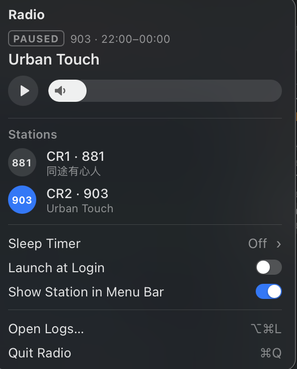

# Radio: 881 / 903 in the macOS menu bar

A menu-bar-only macOS app (no Dock icon) that plays the live streams of Commercial Radio
Hong Kong's CR1 (881) and CR2 (903). Built with **Tauri v2**, Rust and vanilla TypeScript.
The design handoff is in [`design/`](design/).



## Install

1. Download `Radio_x.y.z_universal.dmg` from the [latest release](https://github.com/callyberz/radio-menubar/releases/latest).
2. Open it and drag **Radio** to **Applications**.
3. The app isn't signed yet, so on first launch right-click Radio in Applications → **Open** → **Open**
   (or run `xattr -dr com.apple.quarantine /Applications/Radio.app`). After that it opens normally.

Radio lives in the menu bar (no Dock icon).

## Releasing

Bump `version` in `src-tauri/tauri.conf.json` (and `package.json`), then push a matching tag:

```sh
git tag v0.1.0 && git push origin v0.1.0
```

[`.github/workflows/release.yml`](.github/workflows/release.yml) builds a universal DMG and
creates a **draft** release with it attached. Check it on GitHub and press **Publish**.

## Run it

Requirements: macOS 12+, Node 20.19+ (20.x) or 22.12+, pnpm, Rust (`rustup`), Xcode Command Line Tools.

```sh
pnpm install
pnpm tauri dev      # run in development (Vite + debug Rust build)
pnpm tauri build    # release build
```

The release build produces:

- `src-tauri/target/release/bundle/macos/Radio.app`
- `src-tauri/target/release/bundle/dmg/Radio_0.1.0_aarch64.dmg`

The DMG step drives Finder through AppleScript and sometimes fails ("Can't set statusbar
visible…"). Re-run it, or build only the app with `pnpm tauri build --bundles app`.

Other commands:

```sh
node scripts/gen-icons.mjs                       # regenerate tray frames + app-icon.png
pnpm tauri icon src-tauri/icons/app-icon.png     # regenerate the bundle icon set
cd src-tauri && cargo test                       # unit tests (decoder, playlist rewriting)
cd src-tauri && cargo test -- --ignored live_    # live test against the real site
```

### Debug switches (environment variables)

| Variable | Effect |
| --- | --- |
| `RADIO_DEBUG_SHOW=1` | open the popover at launch |
| `RADIO_DEBUG_PIN=1` | keep the popover open on blur or outside clicks (for screenshots) |
| `RADIO_DEBUG_AUTOPLAY=1` | start playing at launch |
| `RADIO_DEBUG_LOGS=1` | open the Logs window at launch |
| `RADIO_DEBUG_EXPORT_TO=/path/file.txt` | Export writes there (`.json` → JSON) instead of showing a save dialog |
| `RADIO_DEBUG_FAIL_STREAM=1` | make stream resolution fail, to see OFFLINE and the retry backoff |
| `RADIO_DEBUG_THEME=light\|dark` | force the popover's appearance |

Example: `open --env RADIO_DEBUG_SHOW=1 --stderr /tmp/radio.log src-tauri/target/release/bundle/macos/Radio.app`.
Logs go to stderr (`[radio …]` lines).

## Logs & diagnostics

A **Radio — Logs** window shows what the app is doing and every network request it makes.

**Opening it** (it's a single window; opening it again brings it to the front):
- the **Open Logs…** row at the bottom of the popover (⌥⌘L while the popover is focused);
- the status item's **right-click menu → Open Logs…**;
- **⌥-click** on the status item (a plain click still toggles the popover).

While it's open the app becomes a regular app (Dock icon, ⌘-Tab, standard menu bar). When you
close it, the app goes back to menu-bar-only and keeps running. It follows light/dark mode.

**Logs tab:** time (HH:MM:SS.mmm), level, source and message, with level filters
(debug/info/warn/error), search, and warn/error colouring. Sources are generic tags (`app`,
`proxy`, `schedule`, `player`, `tray`, `window`, `provider:881903`, …), so the logging layer
doesn't know about any particular broadcaster. A future plug-in provider just logs as
`provider:<id>`. The Rust side logs stream resolution, the proxy, the schedule and window/tray
events (debug). The webview logs player events (connecting, waiting, stalled, playing, pause,
errors with their `MediaError` code, retries/backoff, volume and station changes) through the
`log_from_ui` command, so everything lands in one stream.

**Network tab:** method, URL, status, content type, size and duration for every outbound
request. That includes API calls, each hop of the `playlist.js` redirect chain,
`cfplaylist.js`, the schedule, and every playlist/segment request the local proxy forwards.
Click a row for a detail pane with request/response headers and the first 2 KB of text bodies.
**HLS segments are grouped** per station per minute ("segments ×5 · all 200 · avg 34 ms ·
164.7 KB"). A group containing a failed segment turns red. Click a group to expand it, or tick
**Show individual segments**.

**Toolbar:** Clear (this tab), Copy (visible rows as text), Export… (visible rows as `.txt` or
`.json` through a save dialog) and Reveal Log File.

**Secrets are redacted by default** (`src-tauri/src/redact.rs`, unit-tested). Cookie values,
`Cookie`/`Set-Cookie` headers, the `r`/`ri`/`n1`/`n2`/`rcft` stream tokens, any token-like
parameter (`*token*`, `*sig*`, `*key*`, `*policy*`, `*auth*`, …) and long opaque base64 runs
show as `•••`.
- Redaction applies when displaying, copying and exporting, not when storing.
- **Show sensitive values** reveals them for the current session only. It isn't saved, so every
  launch starts redacted.
- The **log file is always redacted**:
  `~/Library/Logs/com.calvinlee.radiomenubar/radio.log` (via `tauri-plugin-log`, 2 MB, one file kept).

**Plumbing:** `src-tauri/src/diag.rs` keeps ring buffers in memory (1000 log entries, 500
network entries). The window fills itself with `diag_snapshot` and then receives `diag-log` /
`diag-net` events while it's open. `src-tauri/src/net.rs` wraps every reqwest call (following
redirects by hand so each hop is recorded). The proxy records each forwarded request when its
body finishes streaming.

## Stream URLs: where they live and their status

All URLs are in **`src-tauri/src/config.rs`**.

| What | URL | Status (checked 2026-10-24) |
| --- | --- | --- |
| Stream source API | `https://www.881903.com/api/live/src/{1\|2}` | 200 JSON, returns a tokenised `playlist.js` URL |
| Playlist script | `playlist.881903.com/web/v4/{881hd\|903hd}/playlist.js?t=…` → 302 → `live-s.881903.com/…/cfplaylist.js` | 200, sets CloudFront signed cookies |
| HLS master | `https://live-s.881903.com/edge-aac/{881hd\|903hd}/playlist.m3u8?r=…&ri=…` | 200 `application/vnd.apple.mpegurl` with the cookies, 403 without |
| Segments | `…/chunks.m3u8` → `l_*.aac` | 200 `audio/aac`: ADTS AAC-LC, 22.05 kHz mono, **not encrypted** |
| Schedule | `https://www.881903.com/api/live/toolbar` | 200 JSON, both channels, about 48 h ahead |

This is the same sequence the public web player at https://www.881903.com/live/903 runs
for any visitor: no login, no paywall and no DRM. The master playlist URL is wrapped in
base64 / Crockford-base32 layers inside `cfplaylist.js`. `resolver.rs` unwraps them without
running any remote JavaScript.

The CloudFront cookies are HttpOnly, about 24 h long, path-scoped, tied to your IP /24 and set
on a third-party site, so the webview's `<audio>` element can't use them directly. A tiny
**loopback proxy** (`proxy.rs`, `http://127.0.0.1:<random port>/live/<code>/…`) holds them in
Rust and forwards the playlists and segments. It only forwards to `live-s.881903.com`. Every
time playback starts, a fresh session (new tokens and cookies) is resolved. A 401/403 from
upstream triggers one re-resolve.

**Fragility:** if the broadcaster changes its player (API path, script format, cookie scheme),
resolution fails and the UI shows OFFLINE. `cargo test -- --ignored live_` tells you quickly.
Respect the broadcaster's terms of use; this is for personal listening.

## Known limitations

- **Programme names are shown as the broadcaster publishes them**, mostly in Chinese
  (e.g. 馬路的事之友). The app's UI chrome is English. Times are shown in your local time zone.
- The status item title is plain text (`903 14:58`). The handoff's 11 pt / 60 % styling of
  the countdown isn't possible with `NSStatusItem` titles through Tauri's API.
- **Escape** is handled by a native key monitor and in the page. Synthetic key events couldn't
  be injected in the test environment, so Escape was checked only indirectly: real keystrokes
  reached the monitor. Clicking outside, clicking the status item and Cmd-Q paths were tested.
- **Logs window:** the save dialog, Reveal Log File, the "Show individual segments" toggle and
  a red (failed) segment group weren't exercised in automated testing. Export was tested
  through `RADIO_DEBUG_EXPORT_TO`.
- **Media keys / Now Playing:** `navigator.mediaSession` is set up (play/pause, next/previous
  = switch station). It was not checked whether WKWebView in a menu bar app actually gets the
  media keys.
- The app is **unsigned**. On another Mac, Gatekeeper will need right-click → Open.
- **Launch at Login** uses a LaunchAgent (`~/Library/LaunchAgents/Radio.plist`) pointing at the
  app's current path. If you move the app, toggle it off and on again.
- On launch the app starts **paused** (it doesn't autoplay at login). The prototype started playing.

## Design → implementation map

| Handoff (SwiftUI) | Here |
| --- | --- |
| `LSUIElement`, no Dock icon | `ActivationPolicy::Accessory` in `setup` + `LSUIElement` in `src-tauri/Info.plist` (merged into the bundle) |
| `NSStatusItem` icon + "903" | `tray.rs`: `TrayIconBuilder`, template image, `set_title("903 29:41")` |
| Bouncing 3-bar level meter | 24 pre-rendered template frames (`scripts/gen-icons.mjs`, 36 px = 18 pt @2x) cycled every 120 ms while LIVE. A static 35 % frame otherwise |
| "Icon only" setting | "Show Station in Menu Bar" row in the popover **and** a checkbox in the status item's right-click menu (saved as `menubarLabel`) |
| Menu, 300 pt, menu material, 12 pt radius | Frameless transparent webview window + `window-vibrancy` (`NSVisualEffectMaterial::Menu`, 12 pt radius), resized to fit its content |
| Opens under the status item | `position_popover` in `lib.rs`: centred under the icon, 4 pt below the menu bar, kept on screen |
| Closes like a menu | Hides on blur, on any click outside (AppKit global mouse-down monitor, `popover_monitors.rs`), on a second status item click, and on Escape |
| System colours / font | `-apple-system`, `AccentColor` (fallback `#0A64D8`), live red `#E5342B`, secondary text = 50 % label. Light and dark via `prefers-color-scheme` |
| Spacing tokens | 6 px menu padding, 14 px row padding, 5 px highlight inset, 6 px highlight radius, 0.5 px separators (`src/styles.css`) |
| `AVPlayer` | `<audio>` in WKWebView (native HLS) through the loopback proxy |
| Live means live | Pausing tears down the source. Resuming resolves a fresh URL and reloads |
| CONNECTING / OFFLINE + backoff | Badge states. Retries at 2 s, 5 s, 15 s, then every 15 s. A stall watchdog (12 s without progress) and a 20 s connect timeout also go OFFLINE |
| Sleep timer submenu | Rust owns the clock (exact while the webview is hidden). The UI shows "mm:ss left" and the tray shows the countdown |
| `SMAppService` | `tauri-plugin-autostart` (LaunchAgent). The switch always shows the plugin's real `isEnabled()` |
| (not in handoff) Logs & diagnostics | `diag.rs`, `net.rs`, `redact.rs`, `logs.html` + `src/logs.ts`. See "Logs & diagnostics" |
| Persistence | `tauri-plugin-store` → `~/Library/Application Support/com.calvinlee.radiomenubar/settings.json` (station, volume, menubarLabel, launchAtLogin) |
| Programme schedule | Real data from the broadcaster's timetable API, refetched every 15 min, current programme recomputed every minute. If unavailable, the programme line and time range are hidden |

### Deliberate differences from the handoff

1. **No on/off switch in the "Radio" header row.** It did the same thing as the round
   play/pause button, so the header is just the title and the round button is the only
   play/pause control (a user request after trying the app).
2. **Sleep Timer options expand inline** under the row, with a rotating chevron, like Wi-Fi's
   "Other Networks", instead of a flyout submenu that wouldn't fit in a 300 pt window.
3. **Extra "Show Station in Menu Bar" row** in the popover for the "Icon only" setting. It's
   also in the right-click menu.
4. **No `tauri-plugin-positioner`.** Its `TrayCenter` on macOS uses the top of the menu bar as
   `y`, so the window would sit under the menu bar. Window setters are also queued, which makes
   correcting its result after the fact racy. The placement maths is simple and done directly.

## Project layout

```
index.html, src/main.ts, src/styles.css   popover UI (state, audio, retry, schedule)
logs.html, src/logs.ts, src/logs.css      Logs window (Logs + Network tabs)
src-tauri/src/lib.rs                      app setup, popover window, commands
src-tauri/src/tray.rs                     status item, icon animation, title, sleep clock
src-tauri/src/popover_monitors.rs         outside-click + Escape / Cmd-Q / ⌥⌘L native monitors
src-tauri/src/config.rs                   all external URLs and station ids
src-tauri/src/resolver.rs                 fresh stream session (tokens, cookies, URL decode)
src-tauri/src/proxy.rs                    loopback HLS proxy
src-tauri/src/schedule.rs                 programme timetable
src-tauri/src/diag.rs                     log + network ring buffers, log file, diagnostics commands
src-tauri/src/net.rs                      recorded HTTP client (each request/redirect hop logged)
src-tauri/src/redact.rs                   secret masking for display, export and the log file
src-tauri/capabilities/default.json       permissions for the popover and Logs windows (core, store, autostart)
scripts/gen-icons.mjs                     tray frames + app icon generator (no deps)
```
